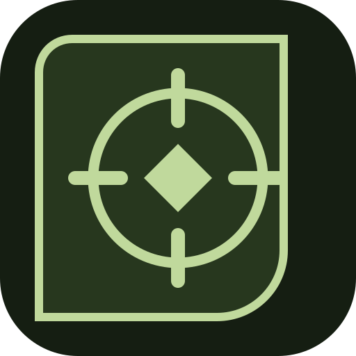
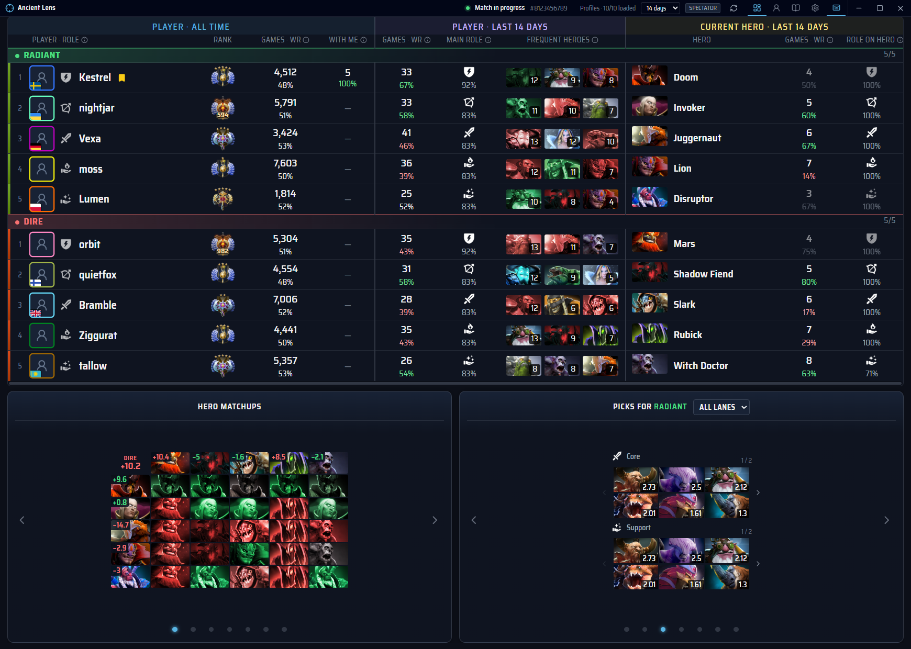

<h1 align="center">Ancient Lens</h1>

  A Dota 2 companion for Windows and Linux with public player statistics, hero draft
  recommendations, notes and an MMR journal. Free, open source, no ads or Ancient Lens account.

  
  
  

  <a href="https://github.com/PavluntiyJ/ancient-lens/releases"><b>Download</b></a> ·
  <a href="#quick-start"><b>Quick start</b></a> ·
  <a href="docs/README.md"><b>Documentation</b></a>

> **Early prototype, 0.7.2.** Unsigned prereleases for Windows and Linux are on the
> [releases page](https://github.com/PavluntiyJ/ancient-lens/releases); you can also
> [build from source](docs/guide/install.md). Not affiliated with Valve.

- **Match analysis:** all ten players with rank, win rate, recent games, main positions and
  their most played heroes, side by side, with parties marked.
- **Draft recommendations:** hero matchups, lane summary, picks for either side, counter and
  meta picks, updated as heroes are picked and banned (needs your STRATZ token).
- **Profile and MMR:** your rank with confidence, an MMR chart, position breakdown and a
  filterable match history, kept even when your match data is private.
- **Player cards and notes:** hover a player for recent matches, earlier games with or
  against you, an editable note, and links to Dotabuff, OpenDota, STRATZ and Steam.

In 0.7.2, the match screen holds still at window sizes where it used to jump on Windows, the
match window opens in front of the profile window, and the profile window opens centred. See
the [changelog](CHANGELOG.md#072--october-30-2026).

Screenshots use invented players. A tour of every panel and shortcut:
[the match screen and profile](docs/guide/match-and-profile.md).

## Quick start

1. Install Ancient Lens from the [releases page](https://github.com/PavluntiyJ/ancient-lens/releases)
   or [from source](docs/guide/install.md).
2. Open **Settings → Connect Dota 2** and press **Set up automatically**. It installs the
   GSI file and, after you confirm, restarts Steam to add the `-gamestateintegration`
   launch option.
3. Restart Dota 2 and spectate a match: ten players should appear.
4. Look at the profile window (`Alt+Num 6` shows or hides it, `Alt+Num 5` the match window).
   Your account is detected from Steam; **Set profile manually** is the fallback.
5. The first start asks two optional questions: whether to enable the memory reader
   (below), then whether to connect STRATZ for draft recommendations and faster player
   loading ([details](docs/guide/stats-service.md)). **Not now** skips either one; both
   stay in **Settings → Connections**.

Details and troubleshooting: [setup and data](docs/guide/setup.md), and the
[Fedora guide](docs/guide/fedora.md) on Fedora.

## What works on each platform

| What you get                                                                      | Needs                                   | Windows                         | Linux                                    |
| --------------------------------------------------------------------------------- | --------------------------------------- | ------------------------------- | ---------------------------------------- |
| Public profiles, notes, manual draft, MMR journal, automatic account detection    | Nothing: works out of the box           | Yes                             | Yes                                      |
| 0.7 match layout, player hover card and note controls                            | Public statistics and your local history | Native fixtures checked          | Desktop check pending; CI checks only    |
| Ten-player roster and picks while spectating                                      | Dota GSI setup (Quick start above)      | Yes                             | Yes                                      |
| Matchups, position recommendations, meta and counter picks                        | Your STRATZ token and the local service | Yes                             | Yes                                      |
| Ten-player roster, picks and bans in **your own** match; exact MMR and confidence | Optional memory reader, off by default  | Yes                             | Yes                                      |
| Match and profile windows above the game that leave it the keyboard (and sound)   | Borderless or windowed game             | Yes, sound not yet checked live | X11 only; on Wayland the desktop decides |
| Windows minimize when you switch to another app, stay up when you click the game  | Nothing; can be turned off              | Yes                             | X11, not yet run on a desktop; not on Wayland |
| The window keys work only over Dota and Ancient Lens                              | Nothing; can be turned off              | Yes                             | X11 key-grab fallback only, not yet run on a desktop; not with the desktop portal or on Wayland |
| Native UI verification and failure diagnostics                                  | Isolated synthetic fixtures             | CI before packaging             | Local desktop check; no native CI job    |

In your own match Dota's GSI sends only your own player, on both systems. With the reader
off, an empty enemy roster there is expected, not a failed installation. **Connect STRATZ**
saves your own token and starts the statistics service that ships with the app
([details](docs/guide/stats-service.md)).

**The memory reader is off by default.** The first start asks once whether to enable it;
**Not now** keeps it off. Enabling it allows external, read-only access to
the Dota process: it does not write memory, inject code, or call game functions. The
anti-cheat response is unknown, and game updates may break the reader. Everything else
works without it. Read [setup and data](docs/guide/setup.md#memory-reading) before enabling
it.

### Is this a cheat?

No gameplay automation, no input to the game, nothing drawn by or inside the game, no
modified game files beyond Valve's own GSI setup, and nothing the game hides from you: during
hero selection the optional reader takes picks only, not who is playing. What you see is
public profile statistics and your own match, in two ordinary windows of their own that the
system keeps on top of the game; the game's rendering is not hooked. The one part with an
unknown risk is the
optional memory reader, which is off unless you enable it.
[Safety and fair play](docs/guide/fair-play.md) explains each point, the data sources and the
limits of what we can promise.

## Supported systems and limits

- **Windows and Linux** desktops. macOS is not supported.
- Packages are unsigned and there are no automatic updates; the app tells you when a new
  release is out.
- There is no hosted STRATZ service; without your own, public OpenDota statistics are used,
  with a rate limit and no draft recommendations.
- Exclusive fullscreen covers the windows: use borderless windowed mode or a second
  monitor. On Wayland the desktop controls stacking, focus and the shortcuts, so showing a
  window there puts the game in the background
  ([details](docs/guide/setup.md#windows-hotkeys-and-tray)).
- **Privacy:** notes, settings and the MMR journal stay on your computer. No analytics,
  telemetry or cloud account. Statistics providers see your IP address and the player IDs
  requested; GitHub sees it when the app checks for a new release
  ([details](docs/guide/setup.md#storage-and-privacy)).

Known limitations and plans: [status](docs/status.md). Changes: [changelog](CHANGELOG.md).

## For developers

Build from source with the [installation guide](docs/guide/install.md). Read
[contributing](CONTRIBUTING.md) for the workflow and checks, the
[architecture](docs/dev/architecture.md), [verification](docs/dev/verification.md) and the
[native reader guide](docs/dev/native-reader.md). Report vulnerabilities as described in
[SECURITY.md](SECURITY.md).

## License and attribution

Project code is [MIT licensed](LICENSE). Third-party assets retain their own rights and
licenses; see [THIRD_PARTY_NOTICES.md](THIRD_PARTY_NOTICES.md). Hero portraits, Dota 2
artwork and trademarks belong to Valve. No third-party application binaries, extracted
source, private captures or proprietary datasets are distributed with this project.
