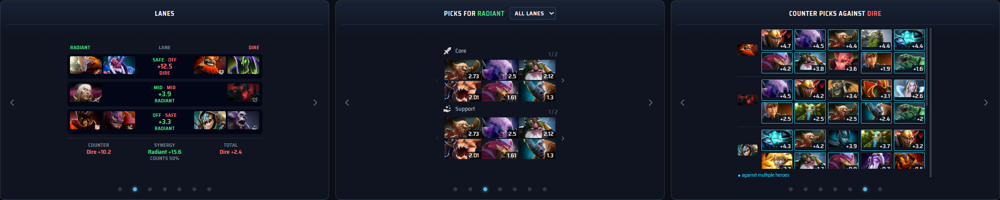
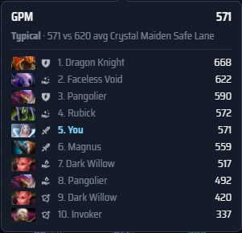
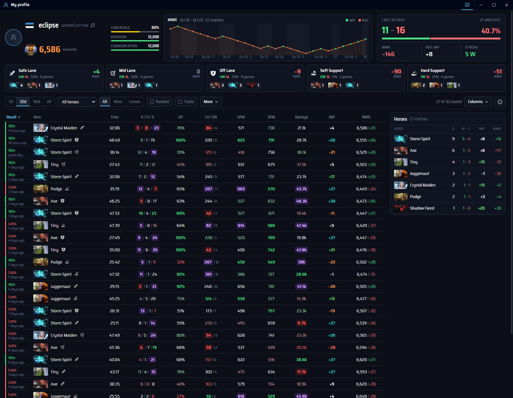

# The match screen and your profile

What each part of the two windows shows: the match window (match table, analysis panels,
Notes and Settings) and the profile window. How they are shown over the game is in
[setup](setup.md#windows-hotkeys-and-tray). How the draft numbers are calculated is in
[the draft guide](draft.md); where the data comes from is in [setup and data](setup.md).
Screenshots use invented players and demonstration statistics; hero portraits are Valve
assets.

## Header and tools

The match window's header has four icons: **Match and draft**, **My profile**, **Notes** and
**Settings**. **My profile** brings up the profile window, which has no header of its own;
`Alt+Num 6` shows or hides it too.
The interface scale is in **Settings → Interface → Appearance**; the match screen also fits
itself to the window, so the scale rarely needs to change during a match.

Tools without a header icon open where they are needed:

- While no game data arrives, the match screen links **Manual draft** (compare heroes against
  picks you enter) and **Add players manually** (the manual roster: paste up to ten Dota IDs or
  profile links).
- When the game provides fewer than ten players, **Add players manually** appears beside that
  message.
- **GSI diagnostics** opens from **Settings → Connect Dota 2**.

The match icon stays lit while the manual draft or roster is open, and the Settings icon while
the diagnostics are.

## Match table

Two teams of five, one row per player:

- this match's role: the lane selected in the draft, or a team-wide guess marked as likely;
- rank, lifetime games and win rate;
- recent games over 7, 14, 30 and 90 days;
- main positions and their shares;
- frequent heroes with spam markers, and statistics for the current hero.

Your own row is marked, earlier meetings show a MET badge, and avatars get the in-game slot
colour when the slot order is known. Missing IDs, private profiles, loading, and stale data
are shown separately. The match screen fits the window down to 90% scale, then scrolls.

## Analysis panels

Hero matchups, lane summary, picks for either side, meta picks, and counter picks. There are
two independent panels, three on a wide window, and they keep their size when switching
views. Switching panels does not fetch again.

| Shortcut    | Action                          |
| ----------- | ------------------------------- |
| `Alt+←/→`   | Switch the left panel           |
| `Shift+←/→` | Switch the right panel          |
| `Alt+↑/↓`   | Change the lane both panels use |
| `Alt+Num 5` | Bring the window over the game  |

In your own match the assigned position sets the initial lane. The window shortcut, tray and
fullscreen notes are in [setup](setup.md#windows-hotkeys-and-tray).

## Draft tracking

Bans drop out of suggestions and counters. Hovered heroes remain tentative. The current match
survives a disconnect, and the last match stays on screen until another one starts.

## Hover cards

Every number has a card that says what it is and where it comes from; column headers with ⓘ
explain formulas and colour bands. Hovering a statistic of a match ranks all ten players of
that match (STRATZ history):

## Player notes and cards

Searchable notes are linked to Dota IDs; **Notes** in the header lists and edits them. A player card shows the full history, teammates and
opponents, with Dotabuff, OpenDota, and STRATZ links. The SMURF label is a public-statistics
heuristic, not proof.

## Personal profile

The profile shows a rank medal with confidence, an interactive MMR chart, position breakdown,
match averages, and history with KP/DP, IMP, building damage, healing, measured MMR changes
and site links. Statistics are coloured against OpenDota hero benchmarks.

Filters cover period, hero, result, modes, position, duration, local start time and weekday,
and patch; active filters show as chips with a Reset. Incomplete history is labelled and can
be extended with **Load more history**. The match journal records your own matches from GSI,
so they stay visible when the account's match data is private. How history is cached and
when it is fetched again: [storage and privacy](setup.md#storage-and-privacy) and
[statistics service limits](stats-service.md#limits-and-failure-handling).

