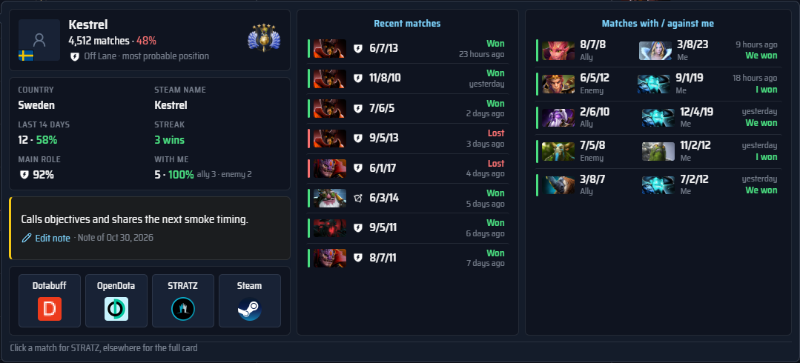

# The match screen and your profile

What each part of the two windows shows: the match window (match table, analysis panels,
Notes and Settings) and the profile window. How they are shown over the game is in
[setup](setup.md#windows-hotkeys-and-tray). How the draft numbers are calculated is in
[the draft guide](draft.md); where the data comes from is in [setup and data](setup.md).
Screenshots use invented players and demonstration statistics; hero portraits are Valve
assets.

## Header and tools

The match window's header has four icons: **Match and draft**, **My profile**, **Notes** and
**Settings**. **My profile** brings up the profile window, which has no header of its own;
`Alt+Num 6` shows or hides it too.
The interface scale is in **Settings → Interface → Appearance**; the match screen also fits
itself to the window, so the scale rarely needs to change during a match.

The match window's title bar shows the phase, match ID, profile-loading progress, statistics
period and refresh control. The match clock is no longer shown above the table. If one
profile fails to load, its row says **Could not load**; hover the player for the reason.

Tools without a header icon open where they are needed:

- While no game data arrives, the match screen links **Manual draft** (compare heroes against
  picks you enter) and **Add players manually** (the manual roster: paste up to ten Dota IDs or
  profile links).
- When the game provides fewer than ten players, **Add players manually** appears beside that
  message.
- **GSI diagnostics** opens from **Settings → Connect Dota 2**.

The match icon stays lit while the manual draft or roster is open, and the Settings icon while
the diagnostics are.

## Match table

Two teams of five, one row per player:

- this match's role: the lane selected in the draft, or a team-wide guess marked as likely;
- rank, lifetime games and win rate;
- recent games over 7, 14, 30 and 90 days;
- main positions and their shares;
- frequent heroes with spam markers, and statistics for the current hero.

Your own row is marked. Each player has one role icon before the name: a lane selected in the
draft, or a dimmer guess. The player's hover card explains which. Avatars get the in-game slot
colour when the slot order is known, with the country flag in the corner.

**With me** counts earlier matches with or against that player in your loaded history, with
your win rate over matches whose result is known. Hover or focus the count for both heroes,
K/D/A and the result from your point of view; click a match to open it on Dotabuff. The current
match is excluded. An empty cell means no meeting was found in the loaded history, not proof
you have never met: older or OpenDota history may have no participant lists.

Missing IDs, private profiles, loading and stale data are shown separately. The match screen
fits the window down to 90% scale, then scrolls. On taller windows the analysis panels grow
more slowly, leaving more room for the ten player rows.

## Analysis panels

Hero matchups, lane summary, picks for either side, meta picks, and counter picks. There are
two independent panels, three on a wide window, and they keep their size when switching
views. Switching panels does not fetch again.

| Shortcut    | Action                          |
| ----------- | ------------------------------- |
| `Alt+←/→`   | Switch the left panel           |
| `Shift+←/→` | Switch the right panel          |
| `Alt+↑/↓`   | Change the lane both panels use |
| `Alt+Num 5` | Bring the window over the game  |

In your own match the assigned position sets the initial lane. The window shortcut, tray and
fullscreen notes are in [setup](setup.md#windows-hotkeys-and-tray).

## Draft tracking

Bans drop out of suggestions and counters. Hovered heroes remain tentative. The current match
survives a disconnect, and the last match stays on screen until another one starts.

## Hover cards

Every number has a card that says what it is and where it comes from; column headers with ⓘ
explain formulas and colour bands. Hovering a statistic of a match ranks all ten players of
that match (STRATZ history):

## Player notes and cards

Hover anywhere in the player cell (avatar, role or name) to open a card beside the row. It
shows the player's rank and all-time matches, country and Steam name, the selected period,
streak and main role, your note, and links to Dotabuff, OpenDota, STRATZ and Steam. The card
lists the newest eight matches in the loaded period and up to ten earlier matches with or
against you, with both heroes, K/D/A and your result. Earlier meetings come from your own
history, so they can appear even for a private profile. Missing values stay unknown.

Move the pointer onto the card to use it. Click a match there to open it on STRATZ, or the
card outside the note and links to open the full player card with history, teammates and
opponents. The SMURF label is a public-statistics heuristic, not proof.

Searchable notes are saved locally by Dota ID; **Notes** in the header lists and edits them.
Click anywhere in the note block to add, edit or delete a note. The marker and card show its
date. Notes now have one kind: older Observation, Good teammate and Watch out notes keep
their text and display the same way. The optional chime and its volume are in
[Settings → Interface → Sound](setup.md#note-sound).

## Personal profile

The profile shows a rank medal with confidence, an interactive MMR chart, position breakdown,
match averages, and history with KP/DP, IMP, building damage, healing, measured MMR changes
and site links. Statistics are coloured against OpenDota hero benchmarks.

Filters cover period, hero, result, modes, position, duration, local start time and weekday,
and patch; active filters show as chips with a Reset. Incomplete history is labelled and can
be extended with **Load more history**. The match journal records your own matches from GSI,
so they stay visible when the account's match data is private. How history is cached and
when it is fetched again: [storage and privacy](setup.md#storage-and-privacy) and
[statistics service limits](stats-service.md#limits-and-failure-handling).

