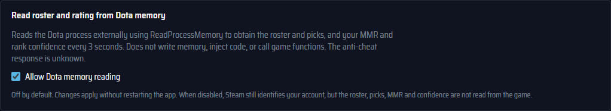

# Connect Dota and understand your data

## Settings at a glance

**Settings** (the gear in the header) opens with **Connections**: one line each for
Dota 2 (GSI), STRATZ and, on Windows and Linux, memory reading. Each says whether it is
connected, needs setup, or is off, with a button to its section. Below, the sections are
grouped: **Connections** (Dota 2, STRATZ, memory reading), **Match & statistics**,
**Interface** (appearance and interface scale, shortcuts, sound, window) and **Data** (data
folder, export and update checks). On a wide window the groups are a list on the left; on a
narrow one they are a row of links above the sections.

## GSI configuration

**Settings → Connections → Dota 2** (the **Connect Dota 2** section) checks the
connection on Windows and Linux: the Steam installation, the Dota 2 library, Ancient
Lens's GSI file, and `-gamestateintegration` in Dota's launch options. When something is missing,
**Set up automatically** fixes it:

- It writes `gamestate_integration_ancient_lens.cfg` into
  `<Dota 2>/game/dota/cfg/gamestate_integration/`.
- It appends `-gamestateintegration` to the existing launch options of the Steam
  account that launched Dota or signed in last (otherwise every account on this
  computer that has played Dota). Steam keeps launch options in
  `userdata/<account>/config/localconfig.vdf` and rewrites that file on exit, so
  this step asks first, then closes Dota 2 and Steam, edits the file, and starts
  Steam again. **Start Dota 2 afterwards** also launches the game. The previous
  file is kept as `localconfig.vdf.ancient-lens-backup`.
- It refuses while GSI reports that you are playing a match, so it never closes
  a running game you are in.

Steam on Linux may be a native, Flatpak, or Snap installation. Nothing is
changed without pressing the button, and isolated test sessions never look at
Steam.

To set it up by hand instead, open **Set up manually**:

1. **Save GSI configuration** and save the file into
   `<Dota 2>/game/dota/cfg/gamestate_integration/`. Create the last folder if needed.
   Find the installation through **Steam → Dota 2 → Manage → Browse local files**.
2. Add `-gamestateintegration` in **Steam → Dota 2 → Properties → Launch Options**
   and restart Dota 2. Then play or spectate a match.

**Open GSI diagnostics** at the end of that section shows what Dota 2 sends right now: the
match, the watched hero and the clock. It is the quickest check that events arrive.

Replace older configurations: the current version requests the `draft` block.
The receiver listens only on `127.0.0.1:32123`, checks a random installation
secret, limits request size, and rejects browser `Origin` headers. The generated
file contains this secret; do not publish it or copy it between installations.
Apart from the setup above, the app does not change game files, Steam settings,
or `coreinit.lua`.

In spectator mode, GSI supplies ten players with IDs and heroes. As a participant,
it supplies only your own player; the `draft` block was empty throughout the
live test on October 13, 2026. Full roster, picks, and bans in your own match
therefore require the optional memory reader. This is the same on Windows and
Linux: an empty enemy roster in your own match, with the reader off, is expected and does
not mean the installation failed. Data becomes stale after 30 seconds without events.

### Optional draft diagnostics

Diagnostics are off by default. To enable them for one Linux launch:

```sh
ANCIENT_GSI_DRAFT_DIAGNOSTICS=1 ./src-tauri/target/release/ancient-lens
```

This writes `gsi-draft-diagnostics.jsonl` in the data folder, capped at 1 MiB
before replacement. It records time, phase, mode, structure shape, and slot
counts, not field values, Steam IDs, player names, or tokens. To check the readers
after a game update, see [the native reader guide](../dev/native-reader.md#after-a-game-update).

## Your profile

**My profile** finds your account without a token. Windows uses the active Steam account
from the registry. Linux uses the Steam login that launched Dota and, when that is
unavailable, your own GSI events. **Set profile manually** is the fallback on both systems.

## Memory reading

**Allow Dota memory reading** is off by default. On the first start Ancient Lens
asks once whether to enable it (**Enable memory reading** or **Not now**); the
question is not repeated. Changes apply immediately and are saved as
`nativeRosterReader` in `state.json`.

After either answer, the app offers **Connect STRATZ** if no statistics service is
configured. This independent, optional step explains faster player loading and
additional match statistics and lets you paste your token directly. **Not now**
(or closing the prompt) dismisses the offer for future launches. You can return
to **Settings → Connections → STRATZ** at any time. See the
[STRATZ connection guide](stats-service.md) for the three setup steps.



| Platform | Readable data                                                                                             | Method                                                                                            |
| -------- | --------------------------------------------------------------------------------------------------------- | ------------------------------------------------------------------------------------------------- |
| Linux    | Current roster, picks, hovers, selected lanes, bans; own MMR, confidence, behavior and communication      | `process_vm_readv`, Source 2 schema and code-shape discovery                                      |
| Windows  | Current roster, picks, hovers, selected lanes, bans; own MMR, rank confidence, behavior and communication | `ReadProcessMemory`, Source 2 schema, PE relocations and MSVC RTTI; rating polled every 3 seconds |

Neither implementation writes game memory, injects code, hooks the game, or
calls game functions. An unfamiliar layout gives an unsupported status instead
of guessed values. The anti-cheat response is unknown. Decide whether to enable
this feature before playing. The app does not relax system memory-access policy.

When disabled, Windows still identifies your account through Steam registry
information. Both keep GSI data. How the readers work, what they validate and on which
game builds they were checked: [native reader guide](../dev/native-reader.md).

## Windows, hotkeys, and tray

Ancient Lens has two windows, both open at start: the **match window** (match table and
draft panels, with Notes and Settings) and the **profile window**. Each is shown or hidden on
its own, by its global key or by its close button (X):

| Window  | Default key |
| ------- | ----------- |
| Match   | `Alt+Num 5` |
| Profile | `Alt+Num 6` |

A key shows its window when it is hidden or minimized and hides it when it is up. On Windows
the numpad keys work with Num Lock on; on Linux the desktop portal binds them with Num Lock off.
The profile icon in the match window's header also brings up the profile window. Change the
keys in **Settings → Interface → Shortcuts**; a combination another application already owns
is reported there and the previous keys stay active. On Linux the keys are registered through
the desktop's GlobalShortcuts portal, so they work whichever window has the keyboard; the
desktop asks to confirm them once and lets you change them (on KDE: **System Settings →
Shortcuts → Ancient Lens**). Without the portal, an X11 key grab is used, which on Wayland
only sees the keys while an X11 window such as the game is focused.

**Keys only over the game.** While Dota is running, the two window keys work only when Dota or
an Ancient Lens window is in front (after clicking a note field, the key still hides that
window). Over a browser or any other application the keys are let go, so that application
receives them as usual; the tray still shows the windows there. While Dota is not running,
the keys work everywhere, to prepare a draft or look at a profile before the game. Turn this
off with **Window keys only while Dota is in front** in **Settings → Interface → Window**.
Whether Dota runs is read from the names in the process list only. On Linux the desktop
portal binds its shortcuts for every application, so this applies only to the X11 key-grab
fallback; on Wayland the active window is unknown and the keys work everywhere.

**Over the game, without muting it.** Both windows stay on top of other windows. On Windows,
and on Linux with X11 when the window manager honours the hint, a window shown by its key or
clicked does not take the keyboard from the game, so the game stays in front and keeps its
sound even when Dota is set to mute in the background. Clicking, scrolling and hover cards
work as usual. Keyboard input:

- Keys you press still go to the game while you click around in Ancient Lens.
- Clicking a text field (a note, a search, a Steam ID, a shortcut to record) or the keyboard
  button in the title bar gives that window the keyboard; the button is lit while it has it.
  The game then goes to the background, as with any other window, until you click back into
  it.
- The analysis panel keys (`Alt+←` and the others) work only while the match window has the
  keyboard. The two global keys always work.
- Maximizing a window from its title bar also gives it the keyboard.

This works over the game in **borderless or windowed mode** only: exclusive fullscreen covers
other windows, so use borderless windowed mode or a second monitor. On Wayland the compositor
controls stacking, focus and position: showing a window activates it, so the game goes to the
background, and keeping a window above the game is set in its window menu (on KDE: **Keep
Above Others**, or a window rule).

**Out of the way of other applications.** When you switch to another application, both
windows hide: activating a browser, a folder, the desktop, the taskbar or Alt+Tab to another
program hides them. Clicking inside Dota, or in the Ancient Lens
windows themselves (a text field included), leaves them up. Bring them back as usual: with
their keys, the tray, or by starting Ancient Lens again. Turn this off with **Hide when you
switch to another app** in **Settings → Interface → Window**. Only which window is active and
the name of its program are read; the game's process is not opened beyond its name, and
nothing is sent to it. On Wayland applications cannot see which other window is active, so
the windows stay up there and the option is disabled. On Linux with X11 the game is recognized
by the program behind the active window's process id (`dota2`).

Closing a window keeps the app in the system tray, so GSI and the rating reader keep running;
the tray menu shows either window, a left click toggles the match window, and **Quit** ends
the app. Turn this off in **Settings → Interface → Window**, which also shows the keys as the
desktop bound them; closing the last visible window then quits. On Linux the tray needs a
StatusNotifier host (KDE Plasma, or GNOME with the AppIndicator extension); without one the
option is disabled. Starting Ancient Lens again while it runs brings both windows back. Both
windows open with the match window in front and the profile window behind it. Each window
remembers its size, and the match window also its position (`.window-state.json` in the
system's application configuration folder, beside but not inside the data directory below);
the profile window opens in the middle of the screen.

These are ordinary desktop windows that the system draws on top: nothing is drawn by or
inside the game, and no input is sent to it. Shortcuts for the analysis panels are listed in
[the match screen guide](match-and-profile.md#analysis-panels).

## Note sound

**Settings → Interface → Sound** controls **Chime for players with a note** and **Chime
volume** (80% by default). A player you have a note about triggers two soft notes, once per
player for the current match you play or watch. Private profiles count too, because notes
are saved locally by Dota ID. All notes use the same sound; the former Watch out chime is gone.

The chime plays at 30% of the selected volume. Release the volume slider or press **Play
note** to hear it. The checkbox turns encounter chimes off.

## Storage and privacy

`state.json` stores notes, account-specific MMR history, the GSI token, and reader
settings. `matches.json` beside it is the match journal: while the app runs, each
match you play is recorded from GSI at post-game (hero, result, duration, K/D/A,
LH/DN, GPM/XPM), later completed by match ID from STRATZ or OpenDota, and shown
in the profile even when the account's match data is private. Display and
statistics preferences (scale, columns, Turbo, ranked only, synergy weight) live
in the window's local storage. The default directory is `%APPDATA%\Ancient Lens` on Windows and
`~/.config/Ancient Lens` on Linux (or `$XDG_CONFIG_HOME/Ancient Lens`). The exact
path appears in Settings. Writes are atomic; invalid state is preserved, and
`state.pre-tauri.json` is created before the first migration.

JSON export includes notes and MMR but omits the GSI secret. **Exports still
contain player IDs, names, notes, and rating history; they are personal backups,
not anonymous diagnostics.** Import is not implemented yet.

`cache/` contains player summaries, account/provider-specific history (STRATZ
history pages include all ten players of each match), hero catalogues, hero
benchmarks, the patch table, and draft statistics. Cached data is labelled stale on network
failure. Removing the app does not remove this data directory automatically.

| Destination                            | When                                                                               | Data sent                                                             |
| -------------------------------------- | ---------------------------------------------------------------------------------- | --------------------------------------------------------------------- |
| Configured statistics service → STRATZ | When configured                                                                    | Player IDs, period, filters; STRATZ token stays in the service        |
| `api.stratz.com`                       | Once per **Connect STRATZ**, to check the token                                    | IP, your token and a query for one public reference profile           |
| `api.opendota.com`                     | Without STRATZ; hero catalogue, benchmarks, patch dates, match by ID, manual draft | IP and requested IDs; requests are paced, with a pause after HTTP 429 |
| `api.opendota.com` (`players/{id}`)    | With STRATZ, once a week per shown player whose STRATZ profile has no country      | IP and the player ID; only the country is used                        |
| `cdn.cloudflare.steamstatic.com`       | Hero portraits                                                                     | Ordinary image requests                                               |
| Steam avatar CDNs                      | Player avatars                                                                     | Ordinary image requests                                               |
| `api.github.com`                       | Release list, 30 s after start and every 12 hours, unless turned off in Settings   | IP only; no account, settings or app version                          |

No analytics, telemetry, or Ancient Lens cloud account is used.

## Troubleshooting

| Symptom                          | Check                                                                                                                                            |
| -------------------------------- | ------------------------------------------------------------------------------------------------------------------------------------------------ |
| No events from Dota              | **Settings → Connect Dota 2** shows what is missing. Otherwise: Steam library, configuration filename, launch option, game restart.              |
| GSI port unavailable             | Close another Ancient Lens instance. Do not expose port 32123 to your network.                                                                   |
| Only your player appears         | Expected participant GSI limitation. The full roster requires **Allow Dota memory reading** in Settings.                                         |
| Memory access denied             | Same user/permissions for game and app; OS process restrictions may still deny access. GSI remains available.                                    |
| Reader unsupported after a patch | Keep memory reading off and report the game/platform version. Do not replace offsets with guesses.                                               |
| Empty draft recommendations      | Press **Connect STRATZ** ([details](stats-service.md)); OpenDota alone does not power these panels.                                              |
| Rate limit or stale statistics   | Wait for the cooldown and retry. Provider coverage can differ; unavailable history does not prove a private profile.                             |
| No Linux MMR measurement         | Enable **Allow Dota memory reading** and start Dota from Steam. Without Steam's launch environment, the rating waits for your first in-game GSI. |
| No automatic profile             | Wait for your own GSI event on Linux or Steam login on Windows, or use **Set profile manually**.                                                 |
| Profile totals look incomplete   | Check period/mode/Turbo filters and the incomplete-sample label; use **Load more history**.                                                      |
